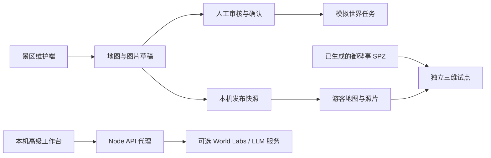

# 技术与服务

维护日期：2026-10-12。本文以仓库代码和生成记录为依据；服务商后续接口、模型与价格变化需在实际接入时另行核对。

## 架构

前端为原生 JavaScript 模块，esbuild 打包；Three.js 与 Spark 播放 SPZ Gaussian Splat。公开 Sites 版本托管静态前端与资产。本机 Node 服务提供可选的生成代理、资料问答和旧版发布快照接口。

模拟任务不会自动生成图中的 SPZ。真实试点已经单独生成、下载并提交仓库。

## 模块

| 文件 | 职责 |
| --- | --- |
| [app.js](../src/app.js) | 路由、首页、旧版导览与高级工作台 |
| [scenic-workflow.js](../src/scenic-workflow.js) | 新游客地图、景点详情、景区维护交互 |
| [scenic-core.js](../src/scenic-core.js) | 六视角规则、草稿确认、模拟任务、发布快照与试点绑定 |
| [scenic-store.js](../src/scenic-store.js) | IndexedDB 持久化、状态迁移、上传校验 |
| [scenic-places.js](../src/scenic-places.js) | 六个景点、实拍元数据与固定补图包 |
| [pilot-world.js](../src/pilot-world.js) | 御碑亭真实资产入口、加载状态、移动与重置 |
| [viewer.js](../src/viewer.js)、[navigation.js](../src/navigation.js) | 三维渲染、相机与导航计算 |
| [core.js](../src/core.js)、[data.js](../src/data.js) | 旧版双语资料、审核、发布、检索和预览路线 |
| [web-images.js](../src/web-images.js) | 原素材标识到网页压缩副本的显示映射 |
| [server.mjs](../server.mjs) | 本机静态文件与可选 API |

## 新工作流状态

当前状态 schema 为 `6`。顶层包含 `draft`、`published`、`publishedAt` 和 `publishNumber`；发布使用独立副本，编辑草稿不直接修改游客内容。

单景点包含地图比例坐标、介绍、`photos`、`revision`、`confirmedRevision`、`world`，以及可选 `pilotAsset`。

- 图片新增、替换或移除递增 `revision`，撤销确认并清除模拟任务结果。
- 确认要求景点名称、六个槽位完整、所有 AI 图片已接受。
- 模拟任务只接受仍与当前素材版本一致的确认。
- 照片发布要求每点位至少一张图片，且所有 AI 图片已审核；不要求所有景点都有模型。
- `pilotAsset` 绑定御碑亭原始正面照片与实际世界 ID，独立于 `world.kind = demo`。
- 旧 schema 迁移保留自定义素材与点位；旧已发布照片快照不会被无条件覆盖成新版默认值。

当前不提供新工作流的云同步、并发编辑或自动跨标签页刷新。切换标签后必要时刷新以读取保存结果。

## 数据存储

| 数据 | 位置 | 范围 |
| --- | --- | --- |
| 新景区草稿和游客快照 | IndexedDB `jingjian-scenic-workspace`，`workspace/current` | 当前浏览器、当前网站来源 |
| 新上传的地图与图片 | 上述状态中的 Data URL | 随新备份导出；未上传云端 |
| 旧导览草稿、版本、交互计数 | localStorage `jingjian-v1` | 与新工作流分离；旧导览有 storage 事件同步 |
| 旧导览用户参考图 | IndexedDB `jingjian-assets` | 旧文字备份不包含这些图片 |
| 旧版世界任务前端状态 | localStorage `jingjian-world-job` | 当前浏览器 |
| 本机分享快照和生成任务 | `data/releases/*.json`、`data/jobs.json` | 当前 Node 服务；不进入 Git |

新工作流的备份可导出但暂无恢复界面；旧导览的 JSON 导入、恢复与回滚是另一套数据格式。

## 两个真实生成资产

| 日期 | 输入与用途 | 生成记录 | 实际消耗 |
| --- | --- | --- | --- |
| 2026-10-10 | AI 湖景概念图；旧 `/#world` | [generation.json](../public/assets/world/generation.json) | 1,580 credits，记录余额 7,000 → 5,420 |
| 2026-10-12 | 御碑亭正面实拍；新 `/#pilot` | [huagang-generation.json](../public/assets/world/huagang-generation.json) | 1,580 credits，记录余额 5,420 → 3,840 |

以上是历史回执，不代表当前账户实时余额，也不是后续生成的价格承诺。两份记录均保存输入、任务或世界 ID、资产信息与核验范围。观看已下载资产不调用生成接口。

御碑亭只提交并成功创建一个世界任务；此前两次 HTTP 422 缺字段校验拒绝未创建任务。素材上传与这次真实生成在开发期间单独完成；相应临时脚本和带签名的上传地址未作为产品功能提交。

当前维护端的五张补图来自内置 imagegen，网页只模拟返回样例。补图 API 与多视角真实生成尚未连成运行时流程。

## 本机 API

这些接口由 [server.mjs](../server.mjs) 实现，公开静态站点不提供该 Node 后端。

| 方法与路径 | 作用 |
| --- | --- |
| `GET /api/health` | 返回本机服务及可选配置是否存在，不返回密钥 |
| `POST /api/releases` | 校验并保存旧版导览发布快照 |
| `GET /api/releases/:id` | 读取指定本机快照 |
| `POST /api/worlds` | 文字或公开 HTTPS 图片 URL 提交真实世界生成 |
| `GET /api/worlds/:operationId` | 查询本机已登记的异步生成任务 |
| `POST /api/guide` | 基于发布资料检索，可选调用兼容 Chat Completions 的服务 |

世界生成代理使用 `WLT-Api-Key`，向 `https://api.worldlabs.ai/marble/v1/worlds:generate` 提交请求；本地 `requestId` 用于避免同一请求被重复提交。提交异常会记为 `uncertain`，应先到服务平台核对，不自动重试付费任务。

本机适配尚未提供通用文件上传、多视角任务编排、场景点位校准和模型自动下载发布。高级工作台读取响应中的资产 URL 加入草稿，不应据此宣称生产链路已经完整。

LLM 配置完整时，`/api/guide` 可将选定点位资料和问题发送给配置的服务；无配置、未知信息或上游失败时使用确定性检索。引用 ID 和响应格式校验不等于逐句事实正确性保证。当前尚未完成真实 LLM 的提供商联调。

## 渲染与资源

Spark 按需加载 500k SPZ，Three.js 负责相机和场景。生成回执中的尺度、地面偏移与初始视点用于渲染配置，不能当作实地测绘结果。

旧版四米硬限制已移除；移动不会生成新几何。没有碰撞、地理导航或无障碍路线验证，远离输入机位可能暴露几何缺失。

网页图片副本由 [prepare-web-images.mjs](../scripts/prepare-web-images.mjs) 生成并提交，映射与哈希见 [manifest.json](../public/assets/web/manifest.json)。[构建脚本](../scripts/build.mjs) 校验原图与副本哈希，打包页面所需资源。原始御碑亭输入和两份 SPZ 保留在部署包，未使用的高清全景图保留于 Git。

## 验证范围

最近一次完整测试记录为 24 项通过，覆盖旧版资料审核发布、导航、新景区快照隔离、六视角门槛、模拟任务失效、真实试点绑定和本机服务契约。测试见 [tests](../tests)。

已进行本地和公开页面的图片加载、六视角切换、三维加载、移动与重置检查。旧 [browser-qa.mjs](../scripts/browser-qa.mjs) 面向早期导览页面，部分路由定位待更新，不是新版地图工作流的完整验收脚本。广泛设备性能、现场精度、伙伴使用效果与真实 LLM 尚未验收。

服务商参考：[World Labs 文档](https://docs.worldlabs.ai/api)、[计费说明](https://docs.worldlabs.ai/api/pricing)、[SPZ 渲染说明](https://docs.worldlabs.ai/api/rendering-spz)、[Three.js](https://threejs.org/docs/)、[Spark](https://sparkjs.dev/docs/overview/)。
